# Temas do Neon TSB Agents no macOS

Capturas do painel renderizadas pelo Neon TSB Agents com duas sessões e quatro subagentes. Escolha um tema no menu **Tema** da barra.

[Instalação no Mac](MACOS.md) · [Voltar ao README](../README.pt-BR.md)

| Mapa de Linhas | Índice Editorial |
| --- | --- |
| 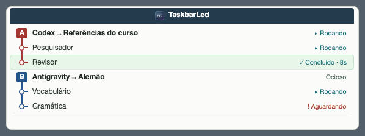 | 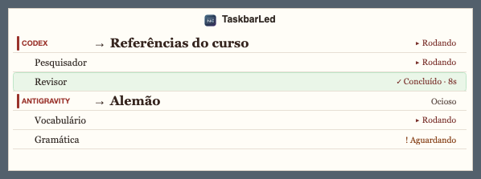 |

| Janela Cobalto | Fósforo Violeta |
| --- | --- |
| 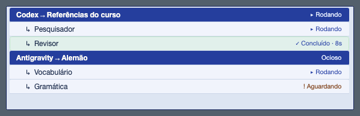 | 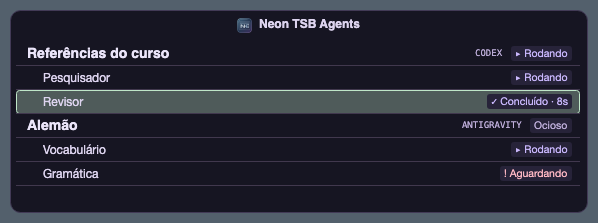 |

| LCD Oliva | Lista Clara |
| --- | --- |
| 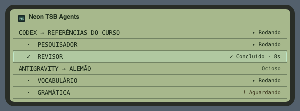 | 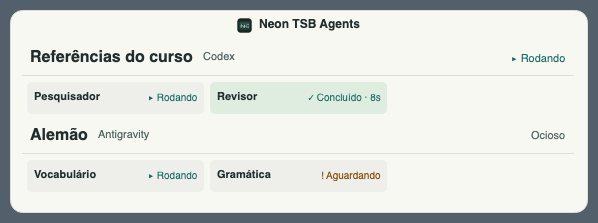 |

| Âmbar em árvore | Carvão compacto |
| --- | --- |
| 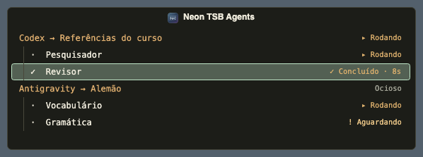 | 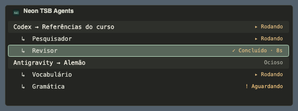 |

| Âmbar com régua | Neon TSB Agents |
| --- | --- |
| 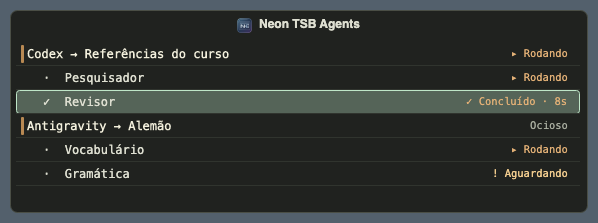 | 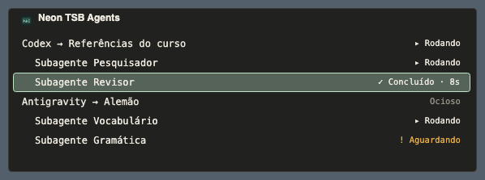 |

| Modern Terminal | Matrix |
| --- | --- |
| 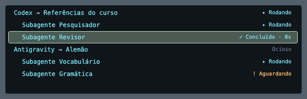 | 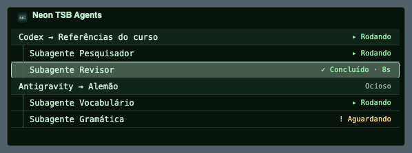 |

| Mono | Minimal |
| --- | --- |
| 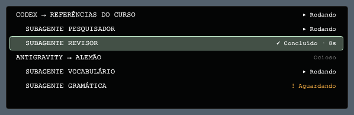 | 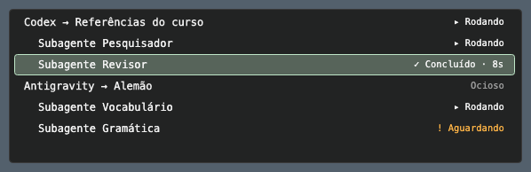 |

| Glass | Paper |
| --- | --- |
| 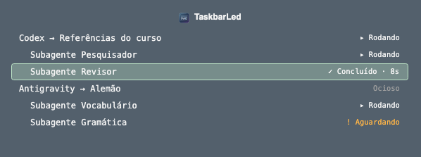 | 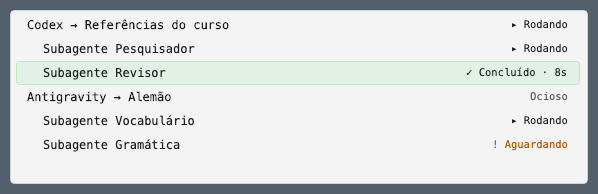 |

| Liquid Glass |
| --- |
| 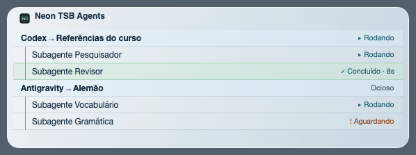 |

A captura de Liquid Glass mostra o gradiente da interface. No macOS 26, o tema acrescenta o material nativo do AppKit sobre o conteúdo atrás da janela.

## Atualizar as capturas

A partir da raiz do repositório, execute os testes de renderização para recriar as imagens.

~~~sh
TASKBARLED_THEME_GALLERY="$PWD/docs/images/macos-themes" dotnet test tests/TaskbarLed.App.Avalonia.Tests -c Release --filter FullyQualifiedName~ThemeGalleryTests
~~~
